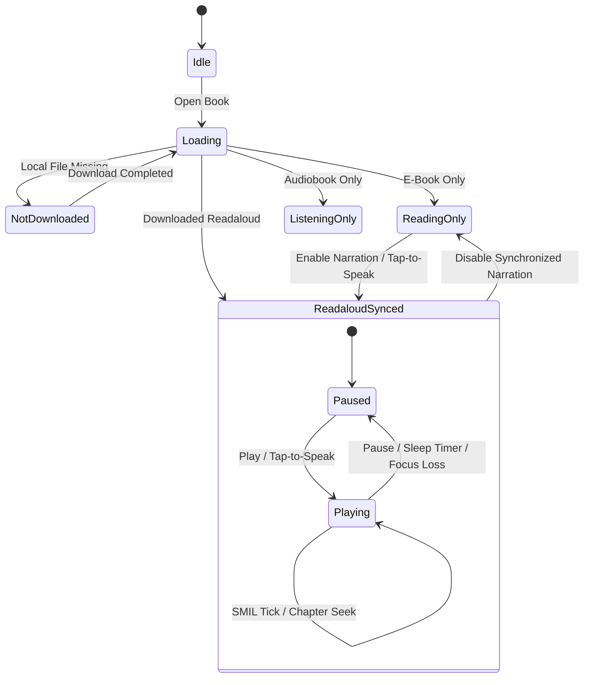

# ARCHITECTURE: "Hello" — Native Android Client for Storyteller

> **Application ID:** `song.hello.reader` (Kotlin package `org.hello.reader`)  
> **Min SDK:** 26 (Android 8.0) | **Target SDK:** 36 (Android 16)  

---

## 1. System Overview & Package Architecture

The application uses a layered architecture with Jetpack Compose UI, ViewModel presentation state, repository-backed data access, Room SQLite persistence, and a shared audio/reading session engine. Multi-tenancy is enforced by scoping server-backed persistent data (Room tables and downloaded files) by `serverId` and `userId`, alongside a local sideloaded library (`serverId = "local"`).

```
org.hello.reader/
├── app/
│   ├── AppContainer.kt                 # Application-scoped dependency container
│   ├── HelloApplication.kt             # Application entrypoint & WorkManager setup
│   ├── HelloNavHost.kt                 # Compose Navigation graph & adaptive shell
│   ├── MainActivity.kt                 # Single-activity host & hardware key dispatch
│   └── MainViewModel.kt                # App-level playback & navigation state
├── core/
│   ├── data/                           # Repositories & local book import
│   │   ├── AnnotationRepository.kt
│   │   ├── BookRepository.kt
│   │   ├── LocalBookImporter.kt
│   │   ├── ReaderPreferencesRepository.kt
│   │   └── ServerConnectionRepository.kt
│   ├── database/                       # Room SQLite persistence (schema v7)
│   │   ├── HelloDatabase.kt
│   │   ├── converter/DatabaseConverters.kt
│   │   ├── dao/
│   │   │   ├── AnnotationDao.kt
│   │   │   ├── BookDao.kt
│   │   │   ├── BookDownloadDao.kt
│   │   │   ├── CollectionDao.kt
│   │   │   ├── SeriesDao.kt
│   │   │   └── SyncCheckpointDao.kt
│   │   └── entity/
│   │       ├── AnnotationEntity.kt
│   │       ├── BookCollectionCrossRef.kt
│   │       ├── BookDownloadEntity.kt
│   │       ├── BookEntity.kt
│   │       ├── BookSeriesCrossRef.kt
│   │       ├── CollectionEntity.kt
│   │       ├── SeriesEntity.kt
│   │       └── SyncCheckpointEntity.kt
│   ├── download/
│   │   └── BookDownloadWorker.kt       # CoroutineWorker for background asset downloads
│   ├── engine/
│   │   ├── BookContentLoader.kt        # EPUB & audio package loader
│   │   ├── audio/
│   │   │   ├── AudioPlaybackController.kt
│   │   │   ├── LibraryPlaybackStarter.kt
│   │   │   ├── MediaLibraryTreeBuilder.kt
│   │   │   ├── NarrationPlayerService.kt
│   │   │   ├── PlaybackSession.kt
│   │   │   ├── SleepTimerManager.kt
│   │   │   └── SmartRewindPolicy.kt
│   │   ├── reader/
│   │   │   └── ReaderStateMachine.kt
│   │   └── smil/
│   │       ├── BookChapters.kt
│   │       ├── EpubOverlayExtractor.kt
│   │       ├── SmilParser.kt
│   │       └── SmilSyncEngine.kt
│   ├── model/                          # Domain models
│   │   ├── Annotation.kt
│   │   ├── Book.kt
│   │   ├── HomeShelf.kt
│   │   ├── ReaderSettings.kt
│   │   ├── ReadingStatusItem.kt
│   │   ├── SeriesAndCollection.kt
│   │   ├── ServerProfile.kt
│   │   └── SyncCheckpoint.kt
│   ├── network/                        # Retrofit + OkHttp + dynamic host routing
│   │   ├── DictionaryService.kt
│   │   ├── DynamicBaseUrlProvider.kt
│   │   ├── NetworkModule.kt
│   │   ├── ServerAuthInterceptor.kt
│   │   ├── ServerUrl.kt
│   │   ├── StorytellerApi.kt
│   │   └── model/
│   │       ├── CatalogParser.kt
│   │       └── StorytellerDtos.kt
│   ├── security/                       # Keystore-backed profile storage
│   │   ├── EncryptedProfileStore.kt
│   │   └── SecurityVault.kt
│   └── util/
│       ├── DeviceProfile.kt            # E-ink hardware detection
│       ├── HardwareKeyDispatcher.kt    # Volume-button page turns
│       └── NaturalOrderComparator.kt
├── feature/
│   ├── library/                        # Home shelves, Library browser, Details, Imports
│   ├── notebook/                       # Cross-book highlights, notes & bookmarks
│   ├── onboarding/                     # Server URL setup, Login, QR scanner, Switcher
│   ├── player/                         # Persistent MiniPlayer bar & FullAudioPlayerSheet
│   ├── reader/                         # Compose EPUB reader, pagination, page curl, foldables
│   ├── settings/                       # Reader typography, theme editor, about & legal sheets
│   └── widget/                         # Jetpack Glance Continue Reading home-screen widget
└── ui/
    ├── components/                     # Shared Compose UI components & wordmark
    └── theme/                          # Material 3 design tokens, typography & color schemes
```

---

## 2. Core Domain Models

### 2.1 Server Profile (`ServerProfile.kt`)

Represents a self-hosted Storyteller server configuration stored in `EncryptedSharedPreferences` backed by the Android Keystore.

```kotlin
@Serializable
data class ServerProfile(
    val id: String,                 // UUID representing this connection profile
    val name: String,               // Friendly display name
    val baseUrl: String,            // Normalized URL without trailing slash
    val authToken: String,          // Bearer token returned by Storyteller
    val refreshToken: String? = null,
    val userId: String,             // Storyteller user ID associated with this session
    val username: String,           // Username used for display
    val isActive: Boolean = false,  // True if currently selected server
    val createdAt: Long = System.currentTimeMillis(),
    val lastUsedAt: Long = System.currentTimeMillis(),
)
```

### 2.2 Book & Format Tracking (`Book.kt`, `BookDownloadEntity.kt`)

A book can offer up to three formats on a Storyteller server (`hasReadaloud`, `hasEbook`, `hasAudiobook`) or exist as a locally imported file (`serverId = "local"`).

```kotlin
enum class BookMediaType {
    READALOUD,    // Synced EPUB 3 + SMIL Media Overlays + Audio
    EBOOK_ONLY,   // EPUB 3 text only
    AUDIO_ONLY,   // Audiobook only (M4B / MP3 / M4A / AAC / audio ZIP)
}

enum class DownloadStatus {
    NOT_DOWNLOADED,
    QUEUED,
    DOWNLOADING,
    DOWNLOADED,
    FAILED,
}
```

`Book` tracks both text (`localFilePath`) and standalone audio (`localAudioPath`) paths so downloading one format never overwrites another format's local files. Per-format download records are persisted in `book_downloads` (`BookDownloadEntity`).

### 2.3 Sync Checkpoint & Reading Statuses (`SyncCheckpoint.kt`, `ReadingStatusItem.kt`)

Tracks reading and listening positions bi-directionally per `(bookId, serverId, userId)`:
- `readingCfi`: EPUB resource href or locator string
- `chapterIndex`, `chapterTitle`, and `chapterProgression`
- `audioPositionMs` and `totalDurationMs`
- `progressPercent` (`0.0f` to `100.0f`)
- `activeSentenceId`: highlighted SMIL fragment ID or audio timestamp locator (`t=<seconds>`)
- `updatedAt` and `isDirty` (queued for upstream push to Storyteller)

** Checkpoint Sync & Conflict Flow (`BookRepository.kt`, `ReaderViewModel.kt`)**:
- While a book is open and advancing (silent reading or active narration), `ReaderViewModel` saves dirty checkpoints locally and pushes positions upstream to `/api/v2/books/{bookId}/positions` every 30 seconds (`PERIODIC_SYNC_INTERVAL_MS`), as well as immediately on pause or reader exit.
- When a position push succeeds, `BookRepository` refreshes the book's metadata (`refreshBookStatusFromServer`) so server-side status changes are reflected locally.
- If a book is marked **To read** (`isToReadStatus`), its stale server progress bar is hidden on cards and detail screens and it is excluded from **Continue reading** until the user actually advances in the book (turning a page while reading or playing audio narration), which promotes the book to **Reading** (`promoteToReadingIfNeeded`).
- Storyteller does not support clearing a book's reading status to null; status updates select one of the server's valid statuses (**To read**, **Reading**, **Read**, or custom server statuses).
- If the server returns HTTP `409` or a remote position newer than the local dirty checkpoint that diverges by more than 60 seconds (`conflictsWith`), a `SyncConflict` is recorded so the user can choose between the server and device position.

---

## 3. Local Persistence Layer: Room Database (`HelloDatabase.kt`)

`HelloDatabase` (version 7, schema exported under `app/schemas/`) enforces multi-tenant isolation through composite primary keys and indices scoped by `(server_id, user_id)`:

- **`books` (`BookEntity`)**: Catalog metadata, format availability flags (`has_readaloud`, `has_ebook`, `has_audiobook`), active `media_type`, `download_status`, `download_progress`, `local_file_path`, `local_audio_path`, `sha256_checksum`, and reading status/ratings metadata.
- **`book_downloads` (`BookDownloadEntity`)**: Per-format (`READALOUD`, `EBOOK_ONLY`, `AUDIO_ONLY`) download status, local path, byte size, and SHA-256 checksum.
- **`sync_checkpoints` (`SyncCheckpointEntity`)**: Foreign-keyed (`CASCADE`) to `books`, storing the latest local/remote reading and audio checkpoint and `is_dirty` sync flag.
- **`annotations` (`AnnotationEntity`)**: Highlights, notes, and bookmarks keyed by `id` and indexed on `(server_id, user_id, book_id)`.
- **`series` (`SeriesEntity`) & `book_series_cross_ref` (`BookSeriesCrossRef`)**: Storyteller series metadata and ordered book memberships.
- **`collections` (`CollectionEntity`) & `book_collection_cross_ref` (`BookCollectionCrossRef`)**: Storyteller collections and memberships.

### Download Progress vs. Completion Updates (`BookDao.kt`)

- `BookDao.updateDownloadProgress(bookId, serverId, userId, status, progress)` updates **only** `download_status` and `download_progress` during queued/in-flight download ticks so existing `local_file_path`, `local_audio_path`, and `sha256_checksum` values are preserved.
- `BookDao.updateDownloadStatus(...)` is called inside a transaction when a download finishes or a format is deleted, reconciling `book_downloads` so remaining downloaded formats stay intact.

---

## 4. Multi-Server Dynamic Network Architecture

Because server endpoints differ per profile, outbound Storyteller HTTP calls pass through `ServerAuthInterceptor`:
1. Rewrites request scheme, host, port, and base path prefix to match the active `ServerProfile` (unless an explicit `X-Target-Base-Url` override header is supplied for a specific profile job).
2. Injects the `Authorization: Bearer <token>` header unless `X-Hello-No-Auth` is present or an explicit `Authorization` header is already set.
3. Emits an authentication-expired callback on HTTP `401` responses for requests bound to the active profile.

`StorytellerApi` supports both Storyteller v1 and v2 API routes for authentication, catalog listing, series/collections, reading statuses, position sync, and format-specific asset streaming (`?format=readaloud`, `?format=ebook`, `?format=audiobook`).

---

## 5. Synchronized Reader, SMIL Engine & Audio Playback

### 5.1 Reader & Playback State Machine (`ReaderStateMachine.kt`, `PlaybackSession.kt`)



A book opens in `ReadaloudSynced` only when its readaloud asset is downloaded on-device (`readaloudDownload != null` or `mediaType == READALOUD` with a local file); `book.hasReadaloud` indicates only that the server offers a readaloud format.

### 5.2 Native Compose EPUB Rendering, CURL Navigation & SMIL Synchronization

`EpubOverlayExtractor` parses the EPUB OPF package, navigation document (TOC), spine XHTML chapters, and SMIL 3 Media Overlay files directly on-device:
- **`SmilParser` & `SmilSyncEngine`**: Normalizes SMIL `<par>` clips into a sorted global timeline across audio tracks. Binary search (`lookupSmilNode(currentTimeMs)`) resolves the active `HighlightEvent(textHref, elementId)` in `O(log N)` time as ExoPlayer advances, and `lookupTimeRange(elementId, textHref)` maps any tapped sentence back to its `clipBeginMs` timestamp.
- **`ReaderCanvas` & `ReaderPagination`**: Renders parsed chapter paragraphs and inline highlights natively in Jetpack Compose (`ReaderTextBlock`), supporting both continuous vertical scroll and viewport-measured pagination (`PageSlice` / `SpreadSlice`).
- **Spread Navigation (`PagedCanvas` & `PageCurlFlipper`)**:
  - In `SLIDE`, `COVER`, and `NONE` page-turn modes, `HorizontalPager` owns the current spread index.
  - In `CURL` (`Flip`) mode, `PageCurlFlipper` renders the current spread directly (without wrapping a `HorizontalPager`), and `PagedCanvas` tracks the spread in `curlSpreadIndex` (`rememberSaveable`). All programmatic page navigation (initial checkpoint restore, chapter jumps, search results, narration auto-follow, tap zones, and hardware volume keys) routes through `goToSpread`, which updates `curlSpreadIndex` and resets `pageCurlState` synchronously in `CURL` mode.
  - When `PageCurlFlipper` completes a forward or backward curl animation, `onTurnCommitted` updates `curlSpreadIndex` before `pageCurlState.reset()` clears `isCurling` in the same synchronous frame so the outgoing page never flashes before the new spread renders.
  - While narration is paused in `ReadaloudSynced`, turning pages updates only the visible spread without overwriting the paused audio position, SMIL highlight, or saved checkpoint; if the user pages away from the active sentence, a **"Jump to audio"** pill scrolls back to the narration position. While narration is playing, manual page turns disengage auto-follow (`isFollowingNarration = false`) until the user taps **"Jump to audio"** or double-taps a sentence on the new page.
- **`FoldableLayout`**: Supports two-page spreads on tablets/unfolded foldables and a split tabletop layout when a foldable hinge is half-opened.
- **`DeviceProfile` (E-Ink Mode)**: Detects e-ink devices (Onyx Boox, Hisense, Kobo, Tolino, PocketBook, Supernote, Boyue/Meebook, Bigme, InkPalm, and rockchip/epd hardware tags) or honors the user's manual toggle to disable page-turn animations and translucency, switch to high-contrast borders, and trigger periodic full-screen refreshes to clear display ghosting.

### 5.3 Docked Mini-Player, Persistent Mini-Player, Full Player & Background Service

- **Inside the Reader (`ReadaloudMiniPlayer` & `ListeningOnlyLayout`)**:
  - In `ReadaloudSynced`, a docked mini-player card at the bottom of the reader displays cover art, chapter title, book progress, play/pause, and an expand button to open `FullAudioPlayerSheet`. It can be collapsed into a floating pill so the full page is unobstructed.
  - In `ListeningOnly` (standalone audiobooks without EPUB text), the reader presents full-screen audio controls directly.
- **Outside the Reader (`MiniPlayer` & `FullAudioPlayerSheet`)**:
  - Leaving the reader while audio is loaded hands the session to `PlaybackSession` (`detach`), keeping the persistent `MiniPlayer` bar visible above the navigation bar on Home, Library, Series, Collections, Book Detail, and Notebook screens.
  - Tapping the `MiniPlayer` card (or the expand button on the reader's docked mini-player) opens `FullAudioPlayerSheet` with chapter scrubbing, transport controls, speed & sleep timer sheets, and chapter selection; tapping the book title in `FullAudioPlayerSheet` navigates into the reader.
- **`AudioPlaybackController` & `NarrationPlayerService`**: Wraps Media3 `ExoPlayer` inside a foreground `MediaLibraryService`. Track items carry structured media IDs (`track_${bookId}_${index}`) so playback transitions from Android Auto or system media controls are reconciled by `PlaybackSession`. On service teardown (`onDestroy`), playback state is snapshotted before releasing `ExoPlayer` and persisted on the application scope.
- **`MediaLibraryTreeBuilder`**: Exposes a browsable Android Auto hierarchy (`Continue Listening`, `Audiobooks`, `Readalouds`) backed by downloaded books and local checkpoints, resolving local cover art through a `ContentProvider` (`content://song.hello.reader.fileprovider/...`).
- **`SmartRewindPolicy` & `SleepTimerManager`**: Applies pause-duration-based smart rewind (`0s` under 5s, `2s` under 1m, `10s` under 30m, `30s` over 30m) and a sleep timer with a linear volume fade-out.
- **`ContinueReadingWidget` & `ContinueReadingWidgetUpdater`**: Jetpack Glance app widget observing the active profile's most recently opened downloaded book (excluding books marked *To read*) and checkpoint to display cover art, title, progress, and a one-tap resume action on the home screen.

---

## 6. Storage Isolation & Directory Layout

All databases, credentials, and downloaded or imported book files reside inside the application's internal sandbox:

```
/data/user/0/song.hello.reader/
├── databases/
│   └── hello_local.db                  # Room DB scoped by (server_id, user_id)
├── datastore/
│   └── reader_preferences.preferences_pb
├── shared_prefs/
│   └── hello_secure_vault.xml          # EncryptedSharedPreferences (AES256-SIV / AES256-GCM)
└── files/
    ├── servers/
    │   └── {server_id}/
    │       └── books/
    │           └── {book_id}/
    │               ├── package.epub    # Downloaded Readaloud EPUB + embedded audio
    │               ├── book.epub       # Downloaded Ebook-only EPUB
    │               ├── audiobook.m4b   # Downloaded single-file audiobook
    │               ├── audio/          # Extracted multi-track audiobook archive
    │               └── narration/      # Extracted readaloud audio tracks for ExoPlayer
    ├── books/
    │   └── local_{uuid}.{epub|m4b|mp3} # Sideloaded local books
    └── covers/
        └── {book_id}.jpg               # Cached & extracted book cover images
```
